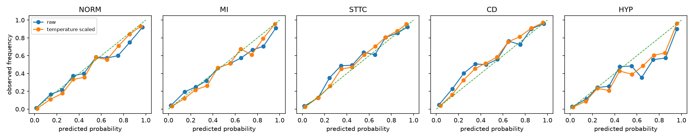
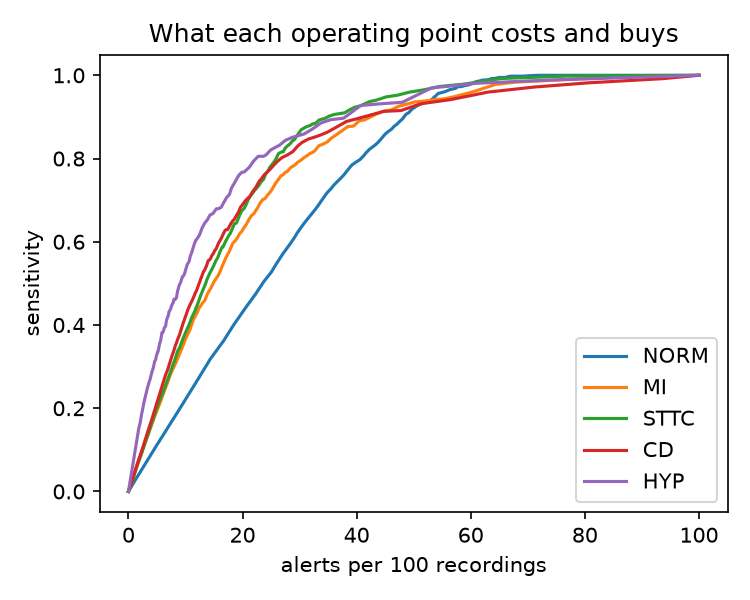

# Calibrated ECG classification on PTB-XL

A small, reproducible study of what happens to an ECG classifier *after* the accuracy number: how well its probabilities are calibrated, and what each operating threshold costs in alerts per hundred recordings against the sensitivity it buys.

Accuracy ranks models. Calibration and operating points decide whether a model is usable at the bedside. This repository keeps the two questions separate and reports both.

## What it does

1. Downloads [PTB-XL](https://physionet.org/content/ptb-xl/) (21,799 twelve-lead ECGs, 10 s, open access under CC BY 4.0) and builds the five diagnostic superclass labels (NORM, MI, STTC, CD, HYP) from the SCP statements.
2. Trains a compact 1-D residual network on the recommended folds (1 to 8 train, 9 validation, 10 test).
3. Measures discrimination (AUROC, AUPRC) and calibration (expected calibration error, reliability diagrams) on the held-out fold, before and after temperature scaling fit on the validation fold.
4. Produces an operating-point table per class: for each threshold, sensitivity, positive predictive value, and alerts per 100 recordings. The table is the artifact a reviewer would actually use to pick a threshold.

## Quickstart

```bash
pip install -e ".[dev]"
scripts/download_ptbxl.sh data/            # about 1.7 GB, one time
ecgcal train   --data data/ptbxl --out runs/baseline   # add --device mps|cuda for a GPU
ecgcal evaluate --run runs/baseline         # metrics, calibration, operating points
ecgcal report  --run runs/baseline          # figures and tables under reports/
```

The download script uses PhysioNet's public S3 mirror through the `aws` CLI when it is installed (minutes), and falls back to a recursive `wget` from physionet.org otherwise (works, but PhysioNet throttles it heavily).

Everything is CPU-runnable: about two minutes per epoch on a 16-core laptop CPU, and a few seconds per epoch with `--device mps` on Apple silicon or `--device cuda`.

## Results

Baseline: `ecgcal train --data data/ptbxl --out runs/baseline --epochs 20 --device mps` (seed 0, 100 Hz, batch 128, AdamW with a one-cycle schedule peaking at 1e-3). The checkpoint with the lowest validation loss is kept (epoch 12 of 20; later epochs overfit). Temperatures are fit per class on fold 9 (2,183 recordings) and everything below is measured on the held-out fold 10 (2,198 recordings). Thresholds are applied to the temperature-scaled probabilities. Table generated by `ecgcal report` (`reports/summary.md`).

| Class | Prevalence | AUROC | AUPRC | ECE (raw) | ECE (temp-scaled) | Temperature | Threshold @ 90% sensitivity | Alerts / 100 ECGs @ that threshold | PPV @ that threshold |
|---|---|---|---|---|---|---|---|---|---|
| NORM | 0.438 | 0.943 | 0.915 | 0.039 | 0.031 | 1.324 | 0.500 | 48.590 | 0.816 |
| MI | 0.250 | 0.910 | 0.807 | 0.034 | 0.021 | 1.316 | 0.170 | 42.448 | 0.531 |
| STTC | 0.237 | 0.934 | 0.825 | 0.029 | 0.016 | 1.231 | 0.170 | 35.214 | 0.607 |
| CD | 0.226 | 0.911 | 0.815 | 0.040 | 0.021 | 1.251 | 0.090 | 42.084 | 0.484 |
| HYP | 0.119 | 0.903 | 0.657 | 0.028 | 0.027 | 1.194 | 0.060 | 40.719 | 0.272 |

Two things the AUROC column does not tell you. Every fitted temperature is above 1, so the raw network was overconfident in all five classes; temperature scaling lowers ECE by 40 to 47% for MI, STTC, and CD, by about 20% for NORM, and barely at all for HYP. And holding 90% sensitivity costs 35 to 49 alerts per 100 recordings depending on the class; for MI, roughly half of those alerts are false (PPV 0.53), and for HYP, the rarest class, about three in four are.





Per-threshold operating-point tables are written to the run directory (`runs/baseline/operating_points_<CLASS>.csv`). These numbers are engineering verification on a public dataset, nothing clinical.

## Why this shape

A model that looks strong on AUROC can still be badly calibrated, and two models with the same AUROC can impose very different alert loads at the sensitivity a clinic requires. Reporting the operating-point table alongside discrimination makes that visible before anyone argues about which model is "better".

## Layout

```
src/ecgcal/
  data.py        download, label construction, fold splits
  model.py       1-D ResNet
  train.py       training loop and CLI
  calibrate.py   ECE, reliability bins, temperature scaling
  thresholds.py  operating-point table
  report.py      figures and markdown tables
tests/           unit tests on synthetic signals (no dataset needed)
scripts/         dataset download
```

## Data and citation

PTB-XL: Wagner, P., Strodthoff, N., Bousseljot, R.-D., Kreiseler, D., Lunze, F. I., Samek, W., & Schaeffter, T. (2020). PTB-XL, a large publicly available electrocardiography dataset. *Scientific Data*, 7, 154. https://doi.org/10.1038/s41597-020-0495-6

The dataset is not redistributed here; the download script fetches it from PhysioNet.

## Status

Scaffold, unit tests, baseline training, and the results table are complete. Engineering verification only; nothing here is clinically validated.

## Author

Ryan F. McCullough, [ryanfmccullough.com](https://ryanfmccullough.com). MIT License.
